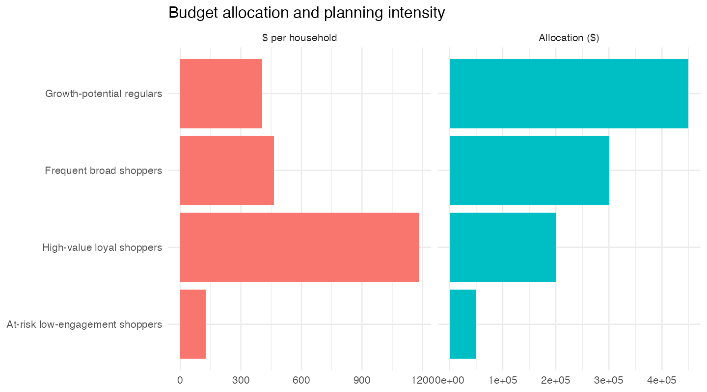
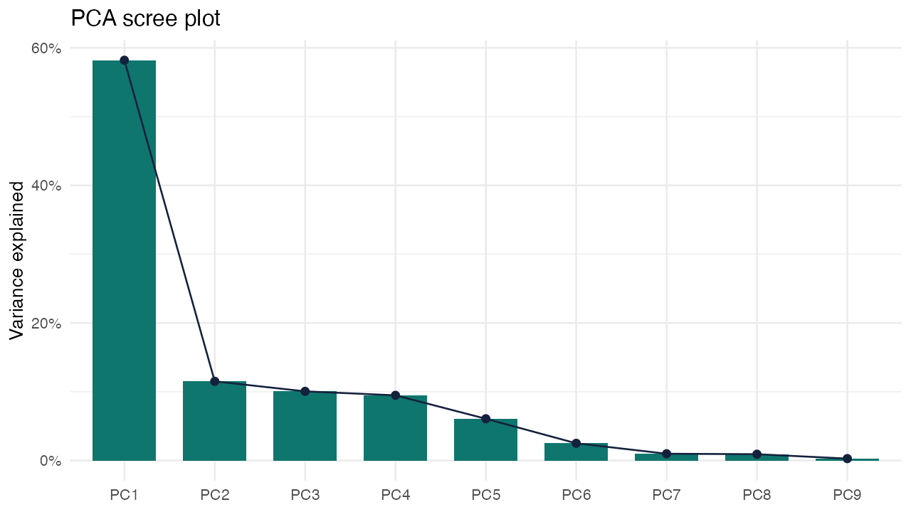
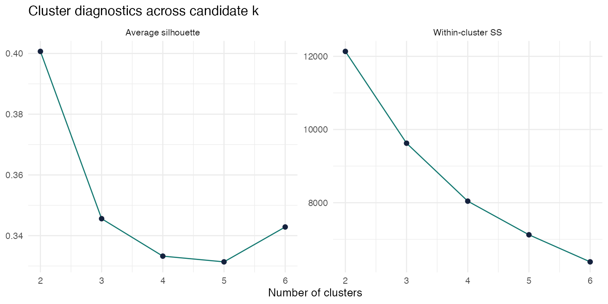
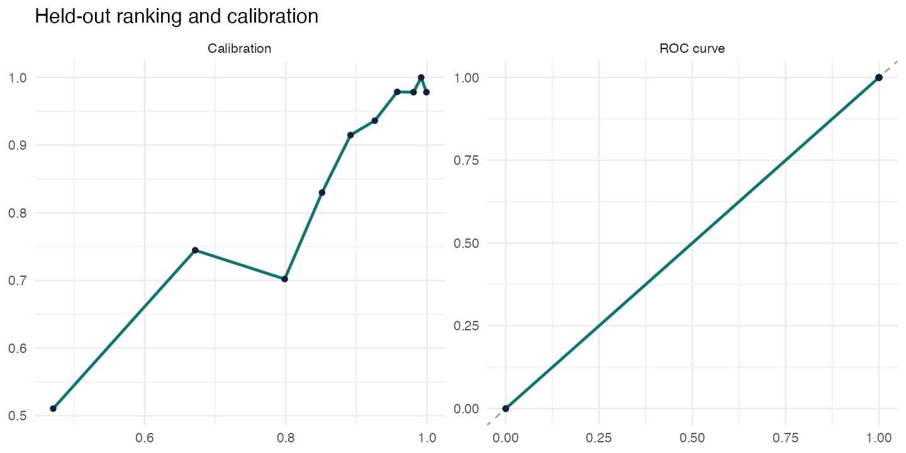

```{r}
#| label: setup
source("../analysis/project_3_analysis.R")
```

# Executive summary

**Project links:** [source code](https://github.com/Brandonlee-2002/customer-segmentation-retention) · [AI use log](https://github.com/Brandonlee-2002/customer-segmentation-retention/blob/main/AI_LOG.md)

**Decision:** allocate the $1,000,000 as a test-first budget: 45% to growth-potential regulars, 30% to frequent broad shoppers, 20% to high-value loyal shoppers, and 5% to at-risk low-engagement shoppers. This prioritizes incremental opportunity while protecting valuable customers efficiently.

This analysis uses `r scales::comma(75000)` household transactions from January 1 through December 31, 2017. The feature period contains `r scales::comma(55853)` transactions and `r nrow(customer_data)` modeled households; the holdout period contains `r scales::comma(19124)` transactions. The observed holdout return rate is `r scales::percent(mean(customer_data$retained), accuracy = 0.1)`.

The analysis identifies four actionable groups. High-value loyal shoppers have the greatest observed value and return rate, but they do not automatically receive the largest budget because many are likely to return without an expensive intervention. The largest experimental allocation goes to growth-potential regulars, who have substantial value and a lower return rate than the two most active groups. The proposed allocation is deliberately non-equal and totals $1,000,000.

This is a prioritization framework, not a causal estimate. The recommended campaign must use treatment and control groups to measure incremental purchases, revenue, margin, and retention.

# Recommendation: Test-First Budget Across Four Segments

```{r}
budget <- readr::read_csv("../output/budget_allocation_starting_point.csv", show_col_types = FALSE)
budget_display <- budget |>
  dplyr::mutate(
    allocation = scales::dollar(allocation, accuracy = 1),
    budget_pct = scales::percent(budget_pct, accuracy = 1),
    holdout_return_rate = scales::percent(holdout_return_rate, accuracy = 0.1),
    monetary = scales::dollar(monetary, accuracy = 0.01),
    allocation_per_household = scales::dollar(allocation_per_household, accuracy = 1)
  ) |>
  dplyr::select(segment_label, customers, holdout_return_rate, monetary, marketing_action, allocation, budget_pct, allocation_per_household, justification)
budget_total <- tibble::tibble(
  segment_label = "TOTAL",
  customers = sum(budget$customers),
  holdout_return_rate = "—",
  monetary = "—",
  marketing_action = "—",
  allocation = scales::dollar(sum(budget$allocation), accuracy = 1),
  budget_pct = scales::percent(sum(budget$budget_pct), accuracy = 1),
  allocation_per_household = scales::dollar(sum(budget$allocation) / sum(budget$customers), accuracy = 1),
  justification = "Full proposed budget"
)
dplyr::bind_rows(budget_display, budget_total) |>
  knitr::kable(caption = "Table 1. Proposed budget by segment; the $1M is a planning envelope across 2,328 households, not a guaranteed discount per customer.", col.names = c("Segment", "Customers", "Holdout return rate", "Median spend", "Marketing action", "Allocation", "Budget", "$ per household", "Justification"))
```

The allocation logic is:

- **45% ($450,000) to growth-potential regulars:** the largest segment has moderate value and an observed return rate below the two most active groups, creating room for targeted frequency and basket-building tests.
- **30% ($300,000) to frequent broad shoppers:** this is a large, valuable group with a very high return rate. The action emphasizes relevant cross-category offers rather than indiscriminate discounts.
- **20% ($200,000) to high-value loyal shoppers:** this group has the highest median spend and return rate. Retention touches and VIP access protect value while limiting unnecessary discount cost.
- **5% ($50,000) to at-risk low-engagement shoppers:** this group has the lowest spend and return rate. The smaller envelope supports low-cost automated win-back tests; expensive incentives should not be broadly deployed.

The $1M applies to the `r nrow(customer_data)` modeled households, or about `r scales::dollar(sum(budget$allocation) / sum(budget$customers), accuracy = 1)` per household. That is a planning envelope, not a promise to spend that amount on every individual. Success should be measured against a holdout control group using incremental retained households, incremental revenue and margin, cost per incremental retained household, and return on marketing spend. Predicted return probability is not the same as incremental lift, so the highest-probability group should not automatically receive the most money.

The sensitivity check below assumes $500 of incremental 12-month gross margin for each additional retained household. Under that assumption, the loyal segment cannot recoup its full envelope from the observed segment size alone, while the at-risk segment would need 100 incremental retained households, or 25% of the segment. These are break-even planning thresholds, not forecasts.

```{r}
readr::read_csv("../output/budget_sensitivity.csv", show_col_types = FALSE) |>
  dplyr::mutate(
    allocation = scales::dollar(allocation, accuracy = 1),
    allocation_per_household = scales::dollar(allocation_per_household, accuracy = 1),
    assumed_incremental_margin = scales::dollar(assumed_incremental_margin, accuracy = 1),
    break_even_rate = scales::percent(break_even_rate, accuracy = 0.1)
  ) |>
  dplyr::select(segment_label, customers, allocation, allocation_per_household, assumed_incremental_margin, break_even_retained_households, break_even_rate) |>
  knitr::kable(caption = "Table 2. Break-even sensitivity using an assumed $500 incremental 12-month margin per retained household.", col.names = c("Segment", "Customers", "Allocation", "$ per household", "Assumed margin", "Break-even retained", "Break-even rate"))
```

```{r}

```

*Figure 6. The largest allocation goes to growth-potential regulars; the per-household panel makes the planning intensity visible.*

# Data and customer-level feature construction

The source is the `completejourney` R package, using the `transactions_sample`, `products`, and `demographics` tables. The transaction sample contains 75,000 transactions from January 1 through December 31, 2017. Feature construction uses the first nine months; the final three months define the holdout outcome. The 2,328 modeled households are those with at least one feature-period transaction. No transaction rows are excluded beyond the date split; missing demographic values are retained as missing and are not used as model predictors.

The unit of analysis is one household. The binary outcome `retained` equals 1 when the household makes at least one purchase during the holdout period.

```{r}
customer_data |>
  dplyr::summarise(
    households = dplyr::n(),
    retention_rate = mean(retained),
    median_monetary = median(monetary),
    median_frequency = median(frequency)
  ) |>
  dplyr::mutate(
    retention_rate = scales::percent(retention_rate, accuracy = 0.1),
    median_monetary = scales::dollar(median_monetary, accuracy = 0.01)
  ) |>
  knitr::kable(caption = "Table 3. Modeled household population and feature-period summary.", col.names = c("Households", "Return rate", "Median spend", "Median frequency"))
```

The time-based split prevents future purchases from being used as predictors of the same future outcome. Demographic fields are retained in the customer table for possible future targeting, but the initial model focuses on observed behavior and cluster membership.

| Variable | Definition | Unit |
|---|---|---|
| `recency` | Days from the last feature-period purchase to September 30 | Days |
| `frequency` | Distinct baskets in the feature period | Baskets |
| `monetary` | Total `sales_value` in the feature period | Dollars |
| `avg_basket` | `monetary / frequency` | Dollars per basket |
| `product_diversity` | Distinct products purchased | Products |
| `category_count` | Distinct departments purchased | Departments |
| `coupon_transactions` | Distinct baskets with a coupon discount | Baskets |

*Table 4. Behavioral variables used for profiling and prediction.*

# Customer behavior reduces to one dominant activity axis (58% of variance)

```{r}
pca_variance <- readr::read_csv("../output/pca_variance.csv", show_col_types = FALSE)
pca_variance |>
  dplyr::slice_head(n = 5) |>
  dplyr::mutate(
    variance = round(variance, 2),
    proportion = scales::percent(proportion, accuracy = 0.1),
    cumulative = scales::percent(cumulative, accuracy = 0.1)
  ) |>
  knitr::kable(caption = "Table 5. PC1 explains the largest share of standardized behavioral variation.", col.names = c("Component", "Variance", "Share", "Cumulative"))


```

*Figure 1. Scree plot of standardized behavioral variables; PC1 dominates the remaining components.*

PC1 explains `r scales::percent(pca_variance$proportion[1], accuracy = 0.1)` of standardized behavioral variation and is primarily a breadth-and-activity axis: frequency, monetary value, product diversity, category breadth, and manufacturer breadth have the largest negative loadings, while recency is smaller and positive. The sign of a principal component is arbitrary; the important evidence is which variables move together.

PC2 explains `r scales::percent(pca_variance$proportion[2], accuracy = 0.1)` and is dominated by average basket size, with smaller contributions from brand breadth and recency. PC3 explains `r scales::percent(pca_variance$proportion[3], accuracy = 0.1)` and contrasts coupon activity and basket size with broader spending behavior. The first three components explain approximately `r scales::percent(sum(pca_variance$proportion[1:3]), accuracy = 0.1)` of the variation, so PCA is useful for clustering while the original variables remain necessary for business interpretation. Full loadings are provided in Appendix A.

# Four segments balance separation and usability

```{r}
readr::read_csv("../output/cluster_diagnostics.csv", show_col_types = FALSE) |>
  dplyr::mutate(
    total_withinss = round(total_withinss, 2),
    avg_silhouette = round(avg_silhouette, 3)
  ) |>
  knitr::kable(caption = "Table 6. Candidate cluster solutions; silhouette is highest at k = 2, while k = 4 supports more actionable groups.", col.names = c("k", "Within-cluster SS", "Avg. silhouette", "Smallest cluster", "Stability min", "Stability max"))


knitr::include_graphics("../output/figures/clusters_pc1_pc2.png")
```

*Figure 2. Elbow and silhouette diagnostics across candidate values of k.*

*Figure 3. Household clusters projected onto the first two principal components.*

The final choice is **k = 4**. k = 2 has the highest silhouette (0.401), but it yields only two broad actions. k = 4 balances separation and business usability: it produces four distinct profiles with 169, 400, 646, and 1,113 households. Across ten random starts, the smallest cluster ranges from 126 to 220 households for k = 4, so the solution remains usable even when initialization changes. The identical stability ranges for k = 2 and k = 3 indicate those simpler solutions are stable, but they are too coarse for the four-action marketing plan.

# Business segments

```{r}
profiles <- readr::read_csv("../output/segment_profile.csv", show_col_types = FALSE) |>
  dplyr::mutate(
    segment = dplyr::recode(as.character(cluster),
      `1` = "Frequent broad shoppers",
      `2` = "High-value loyal shoppers",
      `3` = "Growth-potential regulars",
      `4` = "At-risk low-engagement shoppers"),
    return_rate = scales::percent(holdout_return_rate, accuracy = 0.1)
  ) |>
  dplyr::left_join(budget |> dplyr::select(segment = segment_label, marketing_action), by = "segment") |>
  dplyr::select(segment, customers, customer_pct, recency, frequency, monetary, avg_basket, product_diversity, PC1, PC2, return_rate, marketing_action)
profiles |>
  dplyr::mutate(
    customer_pct = scales::percent(customer_pct, accuracy = 0.1),
    recency = round(recency, 1),
    frequency = round(frequency, 1),
    monetary = scales::dollar(monetary, accuracy = 0.01),
    avg_basket = scales::dollar(avg_basket, accuracy = 0.01),
    PC1 = round(PC1, 2),
    PC2 = round(PC2, 2)
  ) |>
  knitr::kable(caption = "Table 7. Four segments differ most on recency, frequency, spend, and behavioral breadth.", col.names = c("Segment", "Customers", "% of customers", "Recency (days)", "Frequency (baskets)", "Median spend", "Avg. basket", "Products", "Median PC1", "Median PC2", "Holdout return rate", "Marketing action"))

knitr::include_graphics("../output/figures/segment_profiles.png")
```

*Figure 4. Standardized segment profiles show the behavioral trade-offs behind each label.*

**Frequent broad shoppers (Cluster 1)** have a median of 23 baskets, spend a median of $118.26, and return at an observed rate of 98.5%. They are active and broad shoppers, so personalized cross-category recommendations and loyalty benefits are more appropriate than blanket discounts.

**High-value loyal shoppers (Cluster 2)** are the smallest group at 169 households but have the strongest profile: 46 baskets, median spend of $246.38, 71 products, and a 99.4% observed return rate. Their strategy is value protection—relevant access, early offers, and service—rather than paying customers to do what they already tend to do.

**Growth-potential regulars (Cluster 3)** are the largest group at 1,113 households. They have 8 baskets, median spend of $33.38, and an 86.2% return rate. Their scale, moderate engagement, and room to increase frequency make them the best segment for controlled bundle and frequency-incentive experiments.

**At-risk low-engagement shoppers (Cluster 4)** have median recency of 121.5 days, only 2 baskets, median spend of $6.60, and a 58.2% return rate. They should receive inexpensive automated win-back communication first. Higher-cost discounts should be reserved for randomized tests that demonstrate incremental value.

Segment names are labels for the four k-means clusters.

# Retention prediction is useful for ranking, not causal lift

The model predicts holdout return using behavior variables and the four-cluster label. The evaluation uses a stratified 80/20 split with seed 2025: 1,862 training households and 466 held-out households. Stratification preserves the retained/non-retained outcome mix in both samples.

```{r}
readr::read_csv("../output/model_comparison.csv", show_col_types = FALSE) |>
  dplyr::mutate(
    accuracy = round(accuracy, 3),
    sensitivity = round(sensitivity, 3),
    specificity = round(specificity, 3),
    precision = round(precision, 3),
    roc_auc = round(roc_auc, 3)
  ) |>
  dplyr::select(model, accuracy, sensitivity, specificity, precision, roc_auc) |>
  knitr::kable(caption = "Table 8. Held-out model performance; ROC AUC is the primary ranking metric.", col.names = c("Model", "Accuracy", "Sensitivity", "Specificity", "Precision", "ROC AUC"))

readr::read_csv("../output/confusion_matrix.csv", show_col_types = FALSE) |>
  knitr::kable(caption = "Table 9. In-sample confusion matrix at the 0.5 cutoff (n = 2,328).", col.names = c("Actual return", "Predicted class", "Households"))

readr::read_csv("../output/segment_model_performance.csv", show_col_types = FALSE) |>
  dplyr::mutate(dplyr::across(c(actual_return_rate, mean_predicted_probability, roc_auc), ~ round(.x, 3))) |>
  knitr::kable(caption = "Table 10. Held-out model performance by segment.", col.names = c("Cluster", "Households", "Actual return rate", "Mean predicted probability", "ROC AUC"))


```

*Figure 5. Held-out ROC ranking and calibration by prediction decile.*

The held-out metrics show how well the model ranks customers who return, rather than only how well it fits the observed sample. Always predicting return gives approximately 85.7% accuracy, so the model's 85.4–85.9% accuracy is close to the majority-class baseline. ROC AUC is therefore the more informative measure. The 0.5 cutoff is used for classification metrics because it is easy to interpret, not because it is necessarily the optimal campaign cutoff.

Adding the cluster label does not improve ranking: ROC AUC is 0.826 with clusters versus 0.827 without clusters. Segments are therefore used for targeting strategy, not prediction.

The held-out specificity is only 0.194–0.224, meaning the model catches only about 19–22% of non-returners at the 0.5 cutoff. Because non-returners are the group a win-back campaign cares about, a campaign should tune the threshold using contact capacity, expected margin, and treatment cost.

```{r}
readr::read_csv("../output/model_comparison.csv", show_col_types = FALSE) |>
  dplyr::filter(model == "Always predict return") |>
  dplyr::mutate(dplyr::across(where(is.numeric), ~ round(.x, 3))) |>
  knitr::kable(caption = "Table 11. Majority-class baseline: predicting return for every held-out household.", col.names = c("Model", "Accuracy", "Sensitivity", "Specificity", "Precision", "ROC AUC", "Cutoff"))
```

Calibration is reasonably close overall. The largest absolute gap is 9.6 percentage points in decile 3: predicted return is 0.798 versus observed return of 0.702 across 47 households. Cluster 2 has only 33 held-out households and one non-returner, so its AUC of 0.313 is not meaningful. The coefficient table is provided in Appendix C; the reference segment is Cluster 1. Recency has an odds ratio of 0.994 per day, equivalent to approximately 0.83 over 30 days, holding other variables constant.

The cluster-augmented fit also produces a convergence warning because the smallest, highest-return cluster is close to complete separation. This is another reason to use the held-out ranking metrics for campaign prioritization and to treat individual coefficient significance as exploratory rather than definitive.

# Limitations and next steps

The data support segmentation and prediction, but not a causal claim that a marketing action will create additional purchases. The budget is therefore a planning allocation with explicit assumptions: growth customers receive the largest experimental share, loyal customers receive efficient protection, and low-value at-risk customers receive low-cost contact.

The implementation should randomly assign eligible customers within each segment to treatment and control. Treatment can receive the proposed offer or communication while control receives the current standard experience. After the campaign, compare incremental retention, revenue, gross margin, and cost per incremental retained household. Report results by segment so a profitable overall effect does not hide harm or wasted spending in a smaller group.

The decision would improve with customer-level gross margin, offer redemption and contact costs, channel reachability, historical campaign exposure, and a longer observation window. Those fields would allow the business to estimate expected incremental profit rather than using spend and return as proxies for value.

Next steps:

- Randomize treatment and control within each segment before scaling spend.
- Choose campaign thresholds using contact capacity, expected margin, and the cost of each offer.
- Measure incremental retention, revenue, gross margin, cost per incremental retained household, and return on marketing spend.
- Re-estimate the model and budget after the first campaign cycle using observed lift and customer-level profitability.

# Appendix A: PCA loadings

```{r}
readr::read_csv("../output/pca_loadings.csv", show_col_types = FALSE) |>
  dplyr::select(feature, PC1, PC2, PC3) |>
  dplyr::mutate(dplyr::across(where(is.numeric), ~ round(.x, 3))) |>
  knitr::kable(caption = "Table A1. PCA loadings for the first three components.")
```

# Appendix B: Cluster diagnostics

```{r}
readr::read_csv("../output/cluster_diagnostics.csv", show_col_types = FALSE) |>
  dplyr::mutate(total_withinss = round(total_withinss, 2), avg_silhouette = round(avg_silhouette, 3)) |>
  knitr::kable(caption = "Table B1. Full candidate-k diagnostics and random-start cluster-size stability.")
```

# Appendix C: Logistic coefficients

```{r}
readr::read_csv("../output/logistic_coefficients.csv", show_col_types = FALSE) |>
  dplyr::select(term, estimate, p.value, conf.low, conf.high) |>
  dplyr::mutate(dplyr::across(where(is.numeric), ~ round(.x, 3))) |>
  knitr::kable(caption = "Table C1. In-sample logistic coefficients reported as odds ratios; Cluster 1 is the reference segment.", col.names = c("Term", "Odds ratio", "p-value", "95% low", "95% high"))
```

# Appendix D: Calibration detail

```{r}
readr::read_csv("../output/calibration.csv", show_col_types = FALSE) |>
  dplyr::mutate(dplyr::across(c(mean_predicted_probability, observed_return_rate), ~ round(.x, 3))) |>
  knitr::kable(caption = "Table D1. Held-out calibration by predicted-probability decile.", col.names = c("Probability decile", "Households", "Mean predicted probability", "Observed return rate"))
```
