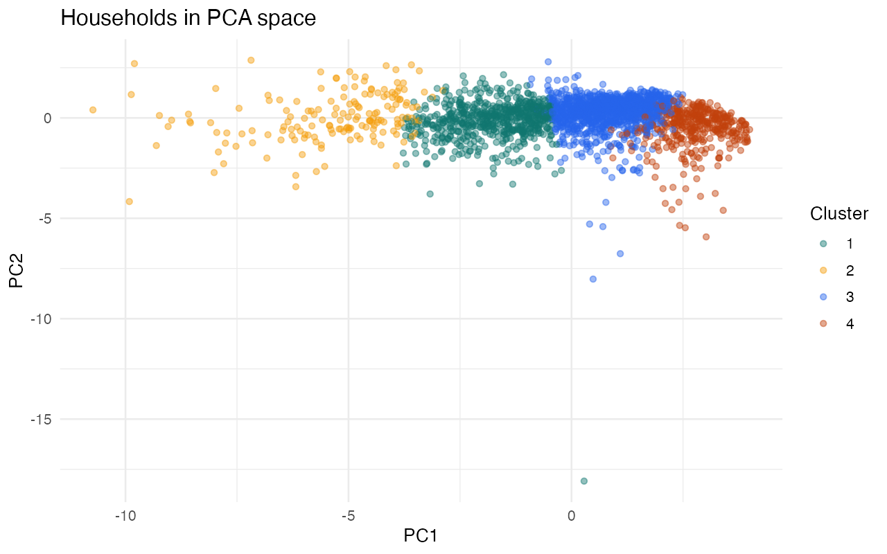
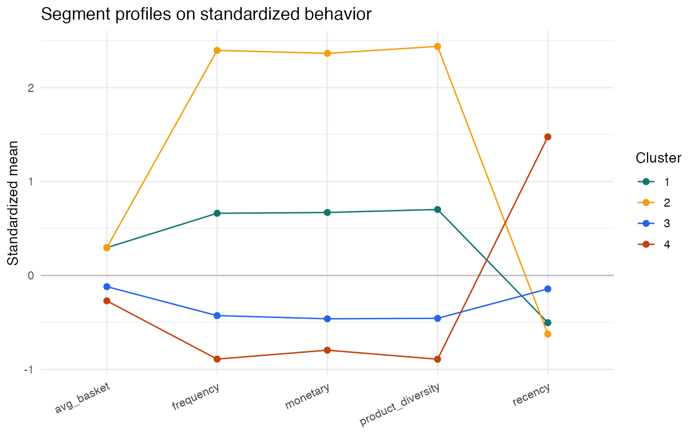

```{r}
#| label: setup
source("../analysis/project_3_analysis.R")
```

# Executive summary

**Project links:** [source code](https://github.com/Brandonlee-2002/customer-segmentation-retention) · [AI use log](https://github.com/Brandonlee-2002/customer-segmentation-retention/blob/main/AI_LOG.md)

::: {.callout-note title="Decision"}
Allocate $1,000,000 as a test-first budget: 45% to growth-potential regulars, 30% to frequent broad shoppers, 20% to high-value loyal shoppers, and 5% to at-risk shoppers. The plan prioritizes growth experiments while protecting valuable customers efficiently.
:::

2017 purchase behavior across 2,328 households separates into four segments with holdout return rates from 58% to 99%. A logistic model ranks return likelihood with held-out ROC AUC of about 0.83, but cluster membership adds no predictive lift. The budget is a planning envelope across the modeled households, not a claim about causal marketing response.

::: {.callout-important title="Caveat"}
These are planning figures, not causal estimates. Every campaign should run against a randomized control group and be evaluated on incremental retention, revenue, gross margin, and cost per incremental retained household.
:::

# Recommendation: Test-First Budget Across Four Segments

```{r}
budget <- readr::read_csv("../output/budget_allocation_starting_point.csv", show_col_types = FALSE)
budget_display <- budget |>
  dplyr::mutate(
    customers = scales::comma(customers),
    allocation = scales::dollar(allocation, accuracy = 1),
    budget_pct = scales::percent(budget_pct, accuracy = 1),
    holdout_return_rate = scales::percent(holdout_return_rate, accuracy = 0.1),
    monetary = scales::dollar(monetary, accuracy = 0.01),
    allocation_per_household = scales::dollar(allocation_per_household, accuracy = 1)
  ) |>
  dplyr::select(segment_label, customers, holdout_return_rate, monetary, marketing_action, allocation, budget_pct, allocation_per_household, justification)
budget_total <- tibble::tibble(
  segment_label = "TOTAL",
  customers = scales::comma(sum(budget$customers)),
  holdout_return_rate = "—",
  monetary = "—",
  marketing_action = "—",
  allocation = scales::dollar(sum(budget$allocation), accuracy = 1),
  budget_pct = scales::percent(sum(budget$budget_pct), accuracy = 1),
  allocation_per_household = scales::dollar(sum(budget$allocation) / sum(budget$customers), accuracy = 1),
  justification = "Full proposed budget"
)
dplyr::bind_rows(budget_display, budget_total) |>
  knitr::kable(caption = "Table 1. Proposed budget by segment; the $1M is a planning envelope across 2,328 households, not a guaranteed discount per customer.", col.names = c("Segment", "Customers", "Holdout return rate", "Median spend", "Marketing action", "Allocation", "Budget", "$ per household", "Justification"))
```

The table is the single source of truth for the recommended allocation. Growth-potential regulars receive the largest envelope because they combine scale with room to increase frequency; at-risk shoppers receive a deliberately small envelope because low-cost win-back should be tested before expensive outreach.

The $1M applies to the `r nrow(customer_data)` modeled households, or about `r scales::dollar(sum(budget$allocation) / sum(budget$customers), accuracy = 1)` per household. That is a planning envelope, not a promise to spend that amount on every individual. Success should be measured against a holdout control group using incremental retained households, incremental revenue and margin, cost per incremental retained household, and return on marketing spend. Predicted return probability is not the same as incremental lift, so the highest-probability group should not automatically receive the most money.

The sensitivity check below uses a labeled $100 illustrative incremental 12-month gross-margin assumption. It is lower than the previous $500 assumption and is not inferred from the observed nine-month spend. Retention-only payback remains infeasible for the broad, loyal, and growth segments because required wins exceed available non-returners; the budget must therefore also target revenue and frequency lift.

```{r}
readr::read_csv("../output/budget_sensitivity.csv", show_col_types = FALSE) |>
  dplyr::mutate(
    allocation = scales::dollar(allocation, accuracy = 1),
    allocation_per_household = scales::dollar(allocation_per_household, accuracy = 1),
    assumed_incremental_margin = scales::dollar(assumed_incremental_margin, accuracy = 1),
    break_even_rate = scales::percent(break_even_rate, accuracy = 0.1)
  ) |>
  dplyr::mutate(
    customers = scales::comma(customers),
    non_returners = scales::comma(non_returners),
    break_even_retained_households = scales::comma(break_even_retained_households),
    feasible_retention_payback = ifelse(feasible_retention_payback, "Yes", "No")
  ) |>
  dplyr::select(segment_label, customers, non_returners, allocation, allocation_per_household, assumed_incremental_margin, break_even_retained_households, break_even_rate, feasible_retention_payback) |>
  knitr::kable(caption = "Table 2. Retention-only break-even check; maximum possible lift is bounded by current non-returners.", col.names = c("Segment", "Customers", "Non-returners (max possible lift)", "Allocation", "$ per household", "Assumed margin", "Break-even needed", "Break-even rate", "Feasible?"))
```

```{r}
```

```{r}
#| fig-alt: "Two-panel chart showing the budget allocation in dollars and dollars per household for the four segments."
knitr::include_graphics("../output/figures/budget_allocation.png")
```

*Figure 1. The largest allocation goes to growth-potential regulars; the per-household panel makes the planning intensity visible.*

# 2,328 households, 85.7% return in the holdout

The source is the `completejourney` R package, using the `transactions_sample`, `products`, and `demographics` tables. The transaction sample contains 75,000 transactions from January 1 through December 31, 2017. Feature construction uses the first nine months; the final three months define the holdout outcome. The 2,328 modeled households are those with at least one feature-period transaction. The feature and holdout windows contain 74,977 transactions; the remaining 23 transactions occur on January 1, 2018 and fall outside the stated 2017 observation window. Missing demographic values are retained as missing and are not used as model predictors.

The unit of analysis is one household. The binary outcome `retained` equals 1 when the household makes at least one purchase during the holdout period.

```{r}
customer_data |>
  dplyr::summarise(
    households = dplyr::n(),
    retention_rate = mean(retained),
    median_monetary = median(monetary),
    median_frequency = median(frequency)
  ) |>
  dplyr::mutate(
    households = scales::comma(households),
    retention_rate = scales::percent(retention_rate, accuracy = 0.1),
    median_monetary = scales::dollar(median_monetary, accuracy = 0.01),
    median_frequency = round(median_frequency, 1)
  ) |>
  knitr::kable(caption = "Table 3. Modeled household population and feature-period summary.", col.names = c("Households", "Return rate", "Median spend", "Median frequency"))
```

The time-based split prevents future purchases from being used as predictors of the same future outcome. Demographic fields are retained in the customer table for possible future targeting, but the initial model focuses on observed behavior and cluster membership.

```{r}
tibble::tribble(
  ~Variable, ~Definition, ~Unit,
  "recency", "Days from the last feature-period purchase to September 30", "Days",
  "frequency", "Distinct baskets in the feature period", "Baskets",
  "monetary", "Total sales_value in the feature period", "Dollars",
  "avg_basket", "monetary / frequency", "Dollars per basket",
  "product_diversity", "Distinct products purchased", "Products",
  "category_count", "Distinct departments purchased", "Departments",
  "manufacturer_count", "Distinct manufacturers purchased", "Manufacturers",
  "brand_count", "Distinct brands purchased", "Brands",
  "coupon_transactions", "Distinct baskets with a coupon discount", "Baskets"
) |>
  knitr::kable(caption = "Table 4. Behavioral variables used for profiling and prediction.")
```

Manufacturer and brand breadth are used in PCA and cluster profiling, but omitted from the logistic model because they overlap strongly with product diversity, category breadth, frequency, and monetary value. This keeps the predictive specification more compact and limits multicollinearity.

# Customer behavior reduces to one dominant activity axis (58% of variance)

```{r}
pca_variance <- readr::read_csv("../output/pca_variance.csv", show_col_types = FALSE)
pca_variance |>
  dplyr::slice_head(n = 5) |>
  dplyr::mutate(
    variance = round(variance, 2),
    proportion = scales::percent(proportion, accuracy = 0.1),
    cumulative = scales::percent(cumulative, accuracy = 0.1)
  ) |>
  knitr::kable(caption = "Table 5. PC1 explains the largest share of standardized behavioral variation.", col.names = c("Component", "Variance", "Share", "Cumulative"))
```

```{r}
#| fig-alt: "Bar chart showing PCA variance explained by component, with PC1 dominant."
knitr::include_graphics("../output/figures/pca_scree.png")
```

*Figure 2. Scree plot of standardized behavioral variables; PC1 dominates the remaining components.*

PC1 explains `r scales::percent(pca_variance$proportion[1], accuracy = 0.1)` of standardized behavioral variation and is primarily a breadth-and-activity axis: frequency, monetary value, product diversity, category breadth, and manufacturer breadth have the largest negative loadings, while recency is smaller and positive. The sign of a principal component is arbitrary; the important evidence is which variables move together.

PC2 explains `r scales::percent(pca_variance$proportion[2], accuracy = 0.1)` and is dominated by average basket size, with smaller contributions from brand breadth and recency. PC3 explains `r scales::percent(pca_variance$proportion[3], accuracy = 0.1)` and contrasts coupon activity and basket size with broader spending behavior. The first three components explain approximately `r scales::percent(sum(pca_variance$proportion[1:3]), accuracy = 0.1)` of the variation, so PCA is useful for clustering while the original variables remain necessary for business interpretation. Full loadings are provided in Appendix A.

# Four segments balance separation and usability

```{r}
readr::read_csv("../output/cluster_diagnostics.csv", show_col_types = FALSE) |>
  dplyr::mutate(
    total_withinss = round(total_withinss, 2),
    avg_silhouette = round(avg_silhouette, 3),
    smallest_cluster = scales::comma(min_cluster_size),
    stability = paste0(stability_min_cluster_size, "–", stability_max_cluster_size)
  ) |>
  dplyr::select(k, total_withinss, avg_silhouette, smallest_cluster, stability) |>
  knitr::kable(caption = "Table 6. Candidate cluster solutions; silhouette is highest at k = 2, while k = 4 supports more actionable groups.", col.names = c("k", "Within-cluster SS", "Avg. silhouette", "Smallest cluster", "Smallest cluster, 10 starts"))
```

```{r}
#| fig-alt: "Two-panel cluster diagnostic chart showing within-cluster sum of squares and average silhouette for k from 2 to 6."
knitr::include_graphics("../output/figures/cluster_diagnostics.png")
```

```{r}
#| fig-alt: "Scatter plot of households on PC1 and PC2 colored by four customer segments."

```

*Figure 3. Elbow and silhouette diagnostics across candidate values of k.*

*Figure 4. Household clusters projected onto the first two principal components.*

The final choice is **k = 4**. k = 2 has the highest silhouette (0.401), but it yields only two broad actions. k = 4 balances separation and business usability: it produces four distinct profiles with 169, 400, 646, and 1,113 households. Across ten random starts, the smallest cluster ranges from 126 to 220 households for k = 4, so the solution remains usable even when initialization changes. The identical stability ranges for k = 2 and k = 3 indicate those simpler solutions are stable, but they are too coarse for the four-action marketing plan.

# Four segments with return rates from 58% to 99%

```{r}
profiles <- readr::read_csv("../output/segment_profile.csv", show_col_types = FALSE) |>
  dplyr::mutate(
    segment = dplyr::recode(as.character(cluster),
      `1` = "Frequent broad shoppers",
      `2` = "High-value loyal shoppers",
      `3` = "Growth-potential regulars",
      `4` = "At-risk low-engagement shoppers"),
    return_rate = scales::percent(holdout_return_rate, accuracy = 0.1)
  ) |>
  dplyr::select(segment, customers, customer_pct, recency, frequency, monetary, avg_basket, product_diversity, return_rate)
profiles |>
  dplyr::mutate(
    customers = scales::comma(customers),
    customer_pct = scales::percent(customer_pct, accuracy = 0.1),
    recency = round(recency, 1),
    frequency = round(frequency, 1),
    monetary = scales::dollar(monetary, accuracy = 0.01),
    avg_basket = scales::dollar(avg_basket, accuracy = 0.01)
  ) |>
  dplyr::select(segment, customers, customer_pct, recency, frequency, monetary, avg_basket, product_diversity, return_rate) |>
  knitr::kable(caption = "Table 7. Four segments differ most on recency, frequency, spend, and behavioral breadth.", col.names = c("Segment", "Customers", "% of customers", "Recency (days)", "Frequency (baskets)", "Median spend", "Avg. basket", "Products", "Holdout return rate"))
```

```{r}
#| fig-alt: "Line chart of standardized behavioral profiles for the four customer segments."

```

*Figure 5. Standardized segment profiles show the behavioral trade-offs behind each label.*

**Frequent broad shoppers (27.7%)** return at 98.5% with little retention headroom; protect value with relevant cross-category recommendations rather than blanket discounts.

**High-value loyal shoppers (7.3%)** return at 99.4% and have the highest spend; protect them with access and service rather than unnecessary discounts.

**Growth-potential regulars (47.8%)** return at 86.2% and are the largest group; test bundles and frequency incentives where scale and headroom overlap.

**At-risk low-engagement shoppers (17.2%)** return at 58.2% and have the lowest value; use low-cost automated win-back before considering expensive offers.

# Retention prediction is useful for ranking, not causal lift

The model predicts holdout return using behavior variables and the four-cluster label. The evaluation uses a stratified 80/20 split with seed 2025: 1,862 training households and 466 held-out households. Stratification preserves the retained/non-retained outcome mix in both samples.

## Ranking performance

```{r}
readr::read_csv("../output/model_comparison.csv", show_col_types = FALSE) |>
  dplyr::mutate(
    accuracy = scales::percent(accuracy, accuracy = 0.1),
    sensitivity = scales::percent(sensitivity, accuracy = 0.1),
    specificity = scales::percent(specificity, accuracy = 0.1),
    precision = scales::percent(precision, accuracy = 0.1),
    roc_auc = round(roc_auc, 3)
  ) |>
  dplyr::select(model, accuracy, sensitivity, specificity, precision, roc_auc) |>
  knitr::kable(caption = "Table 8. Held-out model performance; ROC AUC is the primary ranking metric.", col.names = c("Model", "Accuracy", "Sensitivity", "Specificity", "Precision", "ROC AUC"))

confusion_display <- readr::read_csv("../output/confusion_matrix.csv", show_col_types = FALSE) |>
  dplyr::mutate(
    actual = dplyr::if_else(retained == 1, "Returned: Yes", "Returned: No"),
    predicted = dplyr::if_else(predicted_class == 1, "Predicted: Yes", "Predicted: No")
  ) |>
  dplyr::select(actual, predicted, n) |>
  tidyr::pivot_wider(names_from = predicted, values_from = n, values_fill = 0) |>
  dplyr::arrange(factor(actual, levels = c("Returned: No", "Returned: Yes"))) |>
  dplyr::mutate(dplyr::across(where(is.numeric), scales::comma))
confusion_display |>
  knitr::kable(caption = "Table 9. In-sample confusion matrix at the 0.5 cutoff (n = 2,328).", col.names = c("Actual outcome", "Predicted: No", "Predicted: Yes"))

readr::read_csv("../output/segment_model_performance.csv", show_col_types = FALSE) |>
  dplyr::mutate(
    segment = dplyr::recode(as.character(cluster),
      `1` = "Frequent broad shoppers",
      `2` = "High-value loyal shoppers",
      `3` = "Growth-potential regulars",
      `4` = "At-risk low-engagement shoppers"),
    customers = scales::comma(customers),
    actual_return_rate = scales::percent(actual_return_rate, accuracy = 0.1),
    mean_predicted_probability = scales::percent(mean_predicted_probability, accuracy = 0.1),
    roc_auc = round(roc_auc + 1e-8, 3)
  ) |>
  dplyr::select(segment, customers, actual_return_rate, mean_predicted_probability, roc_auc) |>
  knitr::kable(caption = "Table 10. Held-out model performance by segment.", col.names = c("Segment", "Households", "Actual return rate", "Mean predicted probability", "ROC AUC"))
```

```{r}
#| fig-alt: "Two-panel chart showing the held-out ROC curve and calibration by prediction decile."
knitr::include_graphics("../output/figures/model_evaluation.png")
```

*Figure 6. Held-out ROC ranking and calibration by prediction decile.*

The held-out metrics show how well the model ranks customers who return, rather than only how well it fits the observed sample. Always predicting return gives approximately 85.7% accuracy, so the model's 85.4–85.9% accuracy is close to the majority-class baseline. ROC AUC is therefore the more informative measure. The 0.5 cutoff is used for classification metrics because it is easy to interpret, not because it is necessarily the optimal campaign cutoff.

Adding the cluster label does not improve ranking: ROC AUC is 0.826 with clusters versus 0.827 without clusters. Segments are therefore used for targeting strategy, not prediction.

The held-out specificity is only 0.194–0.224, meaning the model catches only about 19–22% of non-returners at the 0.5 cutoff. Because non-returners are the group a win-back campaign cares about, a campaign should tune the threshold using contact capacity, expected margin, and treatment cost.

## Calibration

Calibration is reasonably close overall. The largest absolute gap is 9.6 percentage points in decile 3: predicted return is 0.798 versus observed return of 0.702 across 47 households. High predicted probabilities generally correspond to higher observed return rates. High-value loyal shoppers have only 33 held-out households and one non-returner, so their AUC of 0.313 is not meaningful.

## Interpretation

The held-out model is useful for ranking but not for claiming that any customer will respond to marketing. The coefficient inference is exploratory because the cluster-augmented fit produces a convergence warning from near-separation in the smallest, highest-return segment.

# Limitations and next steps

The data support segmentation and prediction, but not a causal claim that a marketing action will create additional purchases. The budget is therefore a planning allocation with explicit assumptions: growth customers receive the largest experimental share, loyal customers receive efficient protection, and low-value at-risk customers receive low-cost contact.

The implementation should randomly assign eligible customers within each segment to treatment and control. Treatment can receive the proposed offer or communication while control receives the current standard experience. After the campaign, compare incremental retention, revenue, gross margin, and cost per incremental retained household. Report results by segment so a profitable overall effect does not hide harm or wasted spending in a smaller group.

The decision would improve with customer-level gross margin, offer redemption and contact costs, channel reachability, historical campaign exposure, and a longer observation window. Those fields would allow the business to estimate expected incremental profit rather than using spend and return as proxies for value.

Next steps:

- Randomize treatment and control within each segment before scaling spend.
- Choose campaign thresholds using contact capacity, expected margin, and the cost of each offer.
- Measure incremental retention, revenue, gross margin, cost per incremental retained household, and return on marketing spend.
- Re-estimate the model and budget after the first campaign cycle using observed lift and customer-level profitability.

# Appendix A: PCA loadings {.unnumbered}

```{r}
readr::read_csv("../output/pca_loadings.csv", show_col_types = FALSE) |>
  dplyr::select(feature, PC1, PC2, PC3) |>
  dplyr::mutate(dplyr::across(where(is.numeric), ~ round(.x, 3))) |>
  knitr::kable(caption = "Table A1. PCA loadings for the first three components.")
```

# Appendix B: Cluster diagnostics {.unnumbered}

```{r}
readr::read_csv("../output/cluster_diagnostics.csv", show_col_types = FALSE) |>
  dplyr::mutate(
    total_withinss = round(total_withinss, 2),
    avg_silhouette = round(avg_silhouette, 3),
    stability = paste0(stability_min_cluster_size, "–", stability_max_cluster_size)
  ) |>
  dplyr::select(k, total_withinss, avg_silhouette, min_cluster_size, stability) |>
  knitr::kable(caption = "Table B1. Full candidate-k diagnostics and random-start cluster-size stability.", col.names = c("k", "Within-cluster SS", "Avg. silhouette", "Smallest cluster", "Smallest cluster, 10 starts"))
```

# Appendix C: Logistic coefficients {.unnumbered}

```{r}
readr::read_csv("../output/logistic_coefficients.csv", show_col_types = FALSE) |>
  dplyr::mutate(term = dplyr::recode(term,
    cluster2 = "High-value loyal shoppers vs. Frequent broad shoppers",
    cluster3 = "Growth-potential regulars vs. Frequent broad shoppers",
    cluster4 = "At-risk low-engagement shoppers vs. Frequent broad shoppers")) |>
  dplyr::select(term, estimate, p.value, conf.low, conf.high) |>
  dplyr::mutate(dplyr::across(where(is.numeric), ~ round(.x, 3))) |>
  knitr::kable(caption = "Table C1. In-sample logistic coefficients reported as odds ratios; Frequent broad shoppers are the reference segment.", col.names = c("Term", "Odds ratio", "p-value", "95% low", "95% high"))
```

The reference segment is **Frequent broad shoppers**. Recency has an odds ratio of 0.994 per day, equivalent to approximately 0.83 over 30 days, holding other variables constant. The cluster-augmented fit has near-separation in the smallest segment, so these coefficients are exploratory.

# Appendix D: Calibration detail {.unnumbered}

```{r}
readr::read_csv("../output/calibration.csv", show_col_types = FALSE) |>
  dplyr::mutate(
    customers = scales::comma(customers),
    mean_predicted_probability = scales::percent(mean_predicted_probability, accuracy = 0.1),
    observed_return_rate = scales::percent(observed_return_rate, accuracy = 0.1)
  ) |>
  knitr::kable(caption = "Table D1. Held-out calibration by predicted-probability decile.", col.names = c("Probability decile", "Households", "Mean predicted probability", "Observed return rate"))
```

# Appendix E: Segment PCA positions {.unnumbered}

```{r}
readr::read_csv("../output/segment_profile.csv", show_col_types = FALSE) |>
  dplyr::mutate(segment = dplyr::recode(as.character(cluster),
    `1` = "Frequent broad shoppers",
    `2` = "High-value loyal shoppers",
    `3` = "Growth-potential regulars",
    `4` = "At-risk low-engagement shoppers")) |>
  dplyr::select(segment, PC1, PC2) |>
  dplyr::mutate(dplyr::across(c(PC1, PC2), ~ round(.x, 2))) |>
  knitr::kable(caption = "Table E1. Median PCA positions by business segment.")
```
